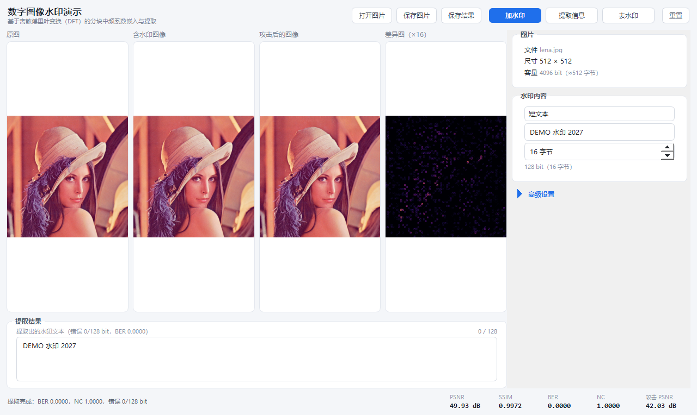

# 基于离散傅里叶变换的数字图像水印嵌入与提取系统

毕业设计项目：**基于离散傅里叶变换的数字图像水印嵌入与提取系统的设计与实现**。

当前状态：**DFT 嵌入/提取基线（无信道编码）已跑通**，含评价指标、攻击模拟、批量实验脚本、单元测试与 PyQt5 演示界面。
下一步接入 Polar 码（SC 译码）。

---

## 1. 已实现的功能

| 模块 | 文件 | 说明 |
|---|---|---|
| DFT 嵌入/提取 | `src/dwtm/dft_watermark.py` | 8×8 分块 DFT，中频等半径系数对相对幅度调制 |
| 端到端流程 | `src/dwtm/pipeline.py` | 亮度通道承载、比特分散、稀疏选块（密钥）、纠错码接入点 |
| 纠错码接口 | `src/dwtm/codes.py` | 无编码基线已实现，Polar 码留出接口 |
| 评价指标 | `src/dwtm/metrics.py` | PSNR、SSIM、BER、NC |
| 攻击模拟 | `src/dwtm/attacks.py` | JPEG、高斯噪声、高斯/中值滤波、亮度、对比度、裁剪、缩放 |
| 载荷编解码 | `src/dwtm/payload.py` | 短文本 / 二值图像 ⇄ 比特 |
| 图形界面 | `src/dwtm/gui.py` | PyQt5 演示窗口：打开图片、加水印、去水印，高级设置折叠 |
| 图像读写 | `src/dwtm/io_utils.py` | 兼容中文路径的 imread/imwrite |
| 脚本 | `scripts/` | 界面启动、单图演示、批量实验、参数标定 |
| 测试 | `tests/` | 29 项单元测试（含界面冒烟测试） |

## 2. 环境

项目用 **Python 3.14**（scoop 的 `python314`）加项目内虚拟环境 `.venv`。依赖只有 numpy / opencv-python / PyQt5，都装在 `.venv` 里，不污染系统 Python。

```powershell
# 首次，或换过 Python 版本之后重建（scoop 只提供 python3 / python314 两个名字）
python3 -m venv .venv
.\.venv\Scripts\python.exe -m pip install -r requirements.txt

# 之后一律用这个解释器
.\.venv\Scripts\python.exe -c "import cv2, numpy, PyQt5.QtWidgets; print('ok')"
```

> `scoop update python314` 会换掉版本目录、旧版本的 site-packages 不再生效，所以升级 Python 后需要重建一次 `.venv`（上面两条命令，约 1 分钟，包会缓存在 pip cache 里）。

## 3. 快速开始

```powershell
# 图形界面（推荐演示用）
.\.venv\Scripts\python.exe scripts\run_gui.py

# 单图：嵌入 -> 不可见性 -> 攻击 -> 提取（结果图存到 results/demo）
.\.venv\Scripts\python.exe scripts\demo_single.py

# 批量实验：5 幅图 x 21 种攻击 -> results/experiments_*.csv 与 summary_*.csv
.\.venv\Scripts\python.exe scripts\run_experiments.py

# 参数标定/对比（论文第 4、5 章的表格来源）
.\.venv\Scripts\python.exe scripts\grid_search.py        # 强度 x 重复次数
.\.venv\Scripts\python.exe scripts\compare_scaling.py    # 尺度基准 local/geometric/global
.\.venv\Scripts\python.exe scripts\compare_repeat.py     # 重复次数折中
.\.venv\Scripts\python.exe scripts\calibrate_strength.py # 系数对组合

# 自检
.\.venv\Scripts\python.exe -m unittest discover -s tests -v
```

### 界面说明



界面按"左看图、右调参"布局，只保留演示需要的动作：

1. **打开图片** → 右侧「图片」里显示文件名、尺寸和可嵌入比特数；
2. **水印内容**：短文本（UTF-8，定长补零）或二值图片（缩放到 32×32 后取 1024 bit）；
3. 点击 **加水印** → 「含水印图像」与「差异图（×16）」出现，底部 PSNR/SSIM 更新；
4. 点击 **提取信息** → 「提取结果」里显示提取出的文本（或 32×32 水印图），底部 BER/NC 与错误比特数更新；
5. 点击 **去水印** → 「处理结果」显示去除水印后的图像，并给出去除图 PSNR 与"再提取"的 BER（应明显升高、文本乱码）。

嵌入强度、重复次数、选块种子、信道编码和攻击模拟折叠在 **高级设置** 里，演示时不需要展开。

窗口按屏幕可用区域自适应（含高 DPI 缩放），最小 980×600，1280×764 及以上分辨率都能完整显示，不需要滚动。

## 4. 算法要点

1. **分块而不做全图 DFT**：8×8 非重叠块与 JPEG 变换网格对齐，裁剪/压缩只影响局部块，也避免全图 DFT 的全局同步问题。
2. **只用"等半径"中频系数对**：(1,2)~2.24、(2,1)~2.24 这类同频半径的系数在自然图像中能量相当，天然差值小，才压得住调制量。实验表明换成不对称对（如 (1,1)/(2,2)）后误码率恒定在 0.6 左右——自然频谱的量级差远大于嵌入量。
3. **相对幅度规则**：令 |C(u1,v1)| − |C(u2,v2)| 的符号表示 1 bit，幅度差 = 强度 × 全图平均幅值。只改幅度不改相位，并同步修改共轭位置，保证 IDFT 为实图像。调制量与亮度偏移无关，所以 ±20 级亮度变化下误码为 0。
4. **全图尺度基准**：强度按**全图**平均中频幅值取，而不是逐块局部能量。逐块取会让纹理/文字图（board、baboon）过度失真；同强度下全图基准的 PSNR 高约 2 dB，Q70 与 5×5 模糊也更好。
5. **稀疏重复 + 随机选块**：每个比特写入 8 个随机块（种子作为密钥），其余块保持原样。相比写满全部 4096 块，PSNR 提高约 5 dB，而 JPEG Q80 下误码仍接近 0（0.002）。
6. **比特交织**：块 k 承载比特 k mod n，局部损伤只会打散到多个比特上，交给重复合并与后续 Polar 译码处理。

## 5. 当前基线结果（5 幅图均值）

`strength=1.2`，`max_repeat=8`，载荷 128 bit（16 字节文本）：

| 项目 | 值 |
|---|---|
| PSNR / SSIM | **43.99 dB / 0.9952** |
| 无攻击 BER / NC | 0 / 1.0 |
| JPEG Q90 / Q80 / Q70 / Q60 / Q50 | 0 / 0.002 / 0.036 / 0.091 / 0.119 |
| 高斯噪声 σ=1…5 | 0 / 0 / 0 / 0.002 |
| 高斯模糊 3×3 / 5×5 | 0.005 / 0.103 |
| 中值滤波 3×3 | 0.047 |
| 亮度 ±10 / ±20 | 全 0 |
| 裁剪 5% / 10% / 20% | 全 0 |
| 缩放 0.75× 往返 | 0 |

> 上表为当前环境（Python 3.14 / numpy 2.5 / OpenCV 5.0）复测的 5 图均值，原始数据在 `results/summary_20261110_233652.csv`。`results/summary_20261101_202704.csv` 是 2026-11-01 旧环境的结果（44.06 dB / Q60 0.078），趋势一致、绝对值略有差异，论文里优先引用当前这一份。单图差异较大：Q60 下 lena 0.242、fruits 0.195，而 baboon / board 为 0，平均值不能代表每幅图。

完整数据见 `results/summary_*.csv`（UTF-8-BOM，可直接用 Excel 打开）。

## 6. 目录结构

```
graduation/
├─ assets/images/          # 8 幅标准测试图（lena/baboon/fruits/board/butterfly/...）
├─ docs/design.md          # 参数决策表、设计依据、已知局限
├─ results/                # 实验 CSV、单图演示输出
├─ scripts/                # 演示与实验脚本
├─ src/dwtm/               # 核心库
└─ tests/                  # 单元测试
```

## 7. 下一步

1. **Polar 码**：固定 (N,K)=(256,128)，高斯近似构造冻结位，SC 译码，替换 `codes.PolarCode` 的 `NotImplementedError`；界面里把"信道编码"下拉框启用。
2. **编码前后对比实验**：同一载荷、同一嵌入位置，比较无编码 / Polar 的 BER、NC（重点看 JPEG Q50–Q60、5×5 模糊）。
3. **论文**：第 3 章算法设计（`docs/design.md`）、第 4 章系统实现（界面截图 + 模块表）、第 5 章实验结果（`results/*.csv`）。

## 8. 已知局限（写进论文"局限与展望"）

- 极平滑块（纯色天空等）中频能量接近 0，几乎无法承载水印；当前实现会浪费这部分容量。
- 该方案对**几何攻击**（旋转、大幅缩放、平移）不鲁棒，任务书未要求，实验中也未纳入。
- 裁剪攻击目前是"挖洞填充"，不涉及重采样与同步问题；若裁掉后重新拼接，需要同步机制。
